# Caustics (beta): how they work, and where to take them

A **caustic** is the bright, sharp pattern that light leaves after it has been bent by something smooth: the
shimmering net on the floor of a swimming pool, the bright curve inside a wine glass, the spot a magnifying glass
burns. The path tracer cannot render most of them, because of how it looks for light. This page explains why, what
the renderer does about it, how that is built, what we measured, and, at the end, where to go to make it better,
faster and quieter.

It is written for someone who knows what a renderer is but not what a photon map is. Skip to the section you need:

| | |
|---|---|
| [1. The problem](#1-the-problem) | why a path tracer cannot make caustics |
| [2. The idea: follow the light](#2-the-idea-follow-the-light) | photons, splats, the photon map; the words used below |
| [3. Who counts what](#3-who-counts-what) | how the estimators share the work without counting light twice |
| [4. One frame, step by step](#4-one-frame-step-by-step) | what the code does, in order |
| [5. Why the picture converges](#5-why-the-picture-converges) | noise, blur, and the radius that shrinks |
| [6. Settings and cost](#6-settings-and-cost) | the knobs; where the time goes |
| [7. What we measured](#7-what-we-measured) | numbers, and what they taught us |
| [8. Limits and known biases](#8-limits-and-known-biases) | what is not covered or not exact |
| [9. Ideas to make it better](#9-ideas-to-make-it-better) | less noise, sharper, faster, quicker to converge |
| [10. Where the code is](#10-where-the-code-is), [11. Working on it](#11-working-on-it) | file map, tests, how to measure a change |

The feature is **beta**: off by default, and it costs nothing while off (the code is compiled out; the setting
recompiles the shader). Its panel is Settings > Path Tracer > **Caustics (beta)**.

| Caustics off | Caustics on |
|---|---|
| 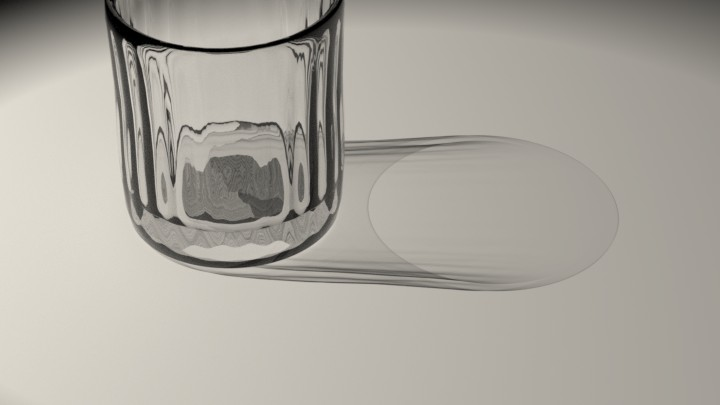 | 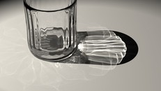 |
| 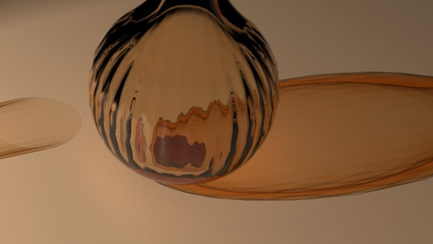 | 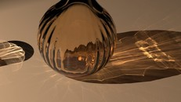 |

The same render with the setting off and on (1024 samples per pixel, no denoiser, same exposure). The scenes are
`CausticsTumbler` and `CausticsAmber` of `gltf_asset_generators` (`generators/props/caustics.py`).

---

## 1. The problem

A path tracer renders a picture by shooting a ray from the camera into the scene, and following it as it bounces.
At each diffuse surface it needs the light that arrives there, and it asks for it in two ways:

- **Shadow ray (next-event estimation).** Pick a point on a light, shoot a ray to it. If nothing is in the way, the
  surface is lit.
- **Bounce ray.** Pick a random direction, and hope the ray reaches a light.

Now put a glass ball between the light and the floor. A **caster** is a surface like that: smooth glass or polished
metal, which bends or mirrors light in exactly one direction instead of scattering it. The shadow ray from the
floor to the light hits the glass and stops: glass blocks it (or, with the *Shadow Transmission* approximation,
lets the light through *straight*, without bending it, which is wrong for a caustic). The bounce ray would have to
refract through the glass and hit the light by chance. For a point light that chance is zero. For an area light it
is small, so the caustic appears as a few lucky bright dots that take forever to converge.

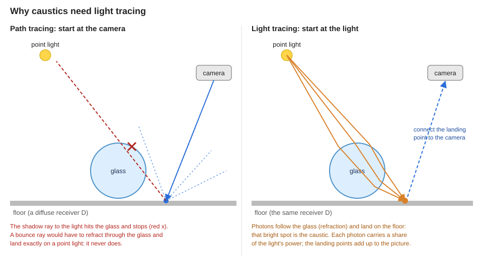

The fix is to work backwards: start at the light.

## 2. The idea: follow the light

### Photons

We shoot **photons** out of the lights. A photon is not a particle with a color: it is one random path sample that
carries a **flux**, a share of the light's power. If the light emits power *P* and we shoot *N* photons, each one
stands for *P / N* (more exactly, *P / (N × the probability of having picked this direction)*: dividing by the
probabilities is what makes the estimate come out right on average).

A photon flies toward the casters, and at each one it is refracted or reflected, the way a real ray of light would
be. It ends at the first surface that is **not** a caster: the **receiver**, for instance the floor. That landing
point, with its flux, is a sample of "light that reached here through glass".

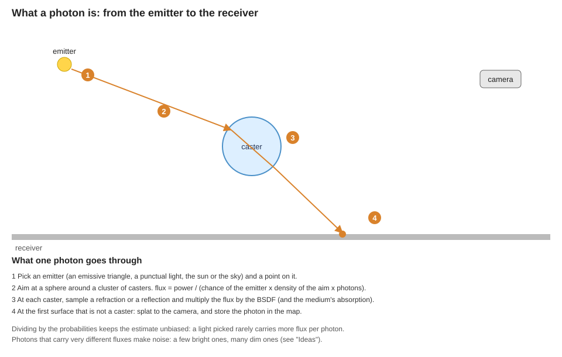

### Two ways to turn photons into pixels

- **Splat (light tracing).** If the camera can see the landing point directly, connect it to the camera with one
  ray (is anything in between?) and add the photon's light to the one pixel it projects to. Each photon lights one
  pixel; many photons fill the picture. There is no blur at all, the caustic is as sharp as the pixels.
- **Gather (photon mapping).** If the camera cannot see the landing point directly, for instance the floor behind
  the water, there is no ray to connect. Instead we keep all the landing points in a **photon map** and, when a
  camera path arrives at a surface point, we **gather** the photons that landed near it (in a small disk) and
  estimate the light at that point from their density: many photons close together means bright.

A gather is a **density estimate**, and it is the only part of this feature with a blur: you decide how big the
disk is. A small disk is sharp but holds few photons, so it is noisy; a big disk is smooth but smears the caustic.
Most of what follows is about handling that trade.

### Vocabulary

| Word | Meaning here |
|---|---|
| **caster** | a smooth glass or polished-metal surface (`isCausticCaster()`) |
| **receiver** | the first surface that is not a caster; where a photon lands and where a camera path wants light |
| **photon**, **flux** | a light sample and the share of power it carries |
| **splat** | adding one photon's light to the one pixel it projects to |
| **photon map** | this frame's landed photons, in a grid the gather can search |
| **gather**, **kernel** | summing nearby photons, weighted by distance (the weight function is the kernel) |
| **radius** | the size of the gather disk |
| **bias** | a systematic error (blur) that does not go away with more samples at the same settings |
| **variance** / **noise** | a random error that averages out with more samples |
| **progressive** | refining over frames: the radius shrinks so that the bias vanishes as the noise averages out |
| **frame**, **accumulation** | one rendered image, and the running average of many of them |

## 3. Who counts what

The path tracer still runs. If it also found the caustic light it would count it twice, so the work is *partitioned*:
every path of light is counted by exactly one estimator. The rule is by **receiver**, the first surface that is not
a caster:

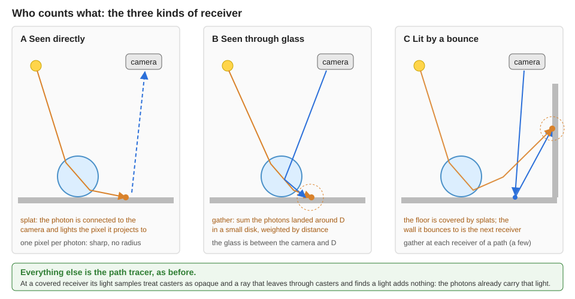

| Light path | Counted by |
|---|---|
| light → casters → receiver → camera, the camera seeing the receiver directly | **splats** |
| light → casters → receiver, any other receiver of a camera path: seen through casters, or after a bounce | **photon map** (a gather at that receiver) |
| everything else | the path tracer, as before |

At a receiver the photons cover, the path tracer **gives up** what the photons carry:

- its light samples treat casters as opaque (instead of the Shadow Transmission filter), and
- a ray that leaves the receiver through casters and finds a light or the sky adds nothing.

A **caster** is defined in one place, `isCausticCaster()` in `shaders/caustics.h.slang`: smooth (roughness at most
`CAUSTIC_MAX_ROUGHNESS`), no diffuse, coat, sheen or scattering part, opaque coverage, and not thin-walled glass
(transmission with no thickness: a window pane bends nothing, so the path tracer's light samples see through it, as
they always did). The photon pass and the path
tracer both read it, so the two sides cannot disagree about what a caster is. (The path tracer classifies a
surface *before* its own roughness regularization, which would make glass look rough after a rough bounce; the
photons see the material as authored.)

How many receivers of a camera path are covered: the primary surface (by splats), and, with the photon map, the
first few that are not casters (`CAUSTIC_MAP_RECEIVERS`). Later ones keep the Shadow Transmission approximation.
The state that tracks it is `PathTracerState::causticChain`, `causticReceiver` and `causticReceivers`
(`shaders/pathtrace_functions.h.slang`), updated by `causticAdvance()`.

## 4. One frame, step by step

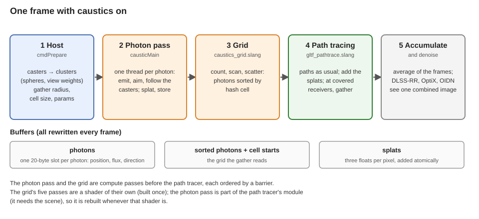

Everything below is redone **every frame**. Nothing is kept from the last one, which is why a changed scene, light,
material or camera needs no cache to be invalidated, whatever the number of nodes.

### 4.1 Host: find the casters, and where to aim (`Caustics::cmdPrepare`)

The host looks at the scene's nodes and finds the ones whose material *may* be a caster. It looks at the material
factors only (a texture can only lower a roughness, so a rough material never is a caster; the shader's per-hit test is
stricter). That list, and each node's box, is rebuilt only when the graph or the materials change
(`Caustics::updateBounds`); a node that only moves costs its own box. That matters for scenes with millions of nodes:
nothing here walks all of them each frame.

The photons aim at **spheres around clusters of casters**, not at one sphere around everything:

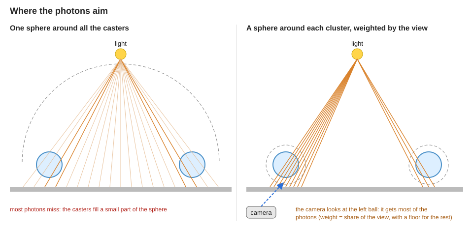

- `Caustics::assignClusters` splits the caster nodes in up to `CAUSTIC_MAX_CASTERS` clusters (largest box first,
  at the median of the centers). Made when the casters change; moving a node only moves its cluster's sphere.
- Each sphere gets a **weight**: the share of the view it fills, plus a floor for what is off screen, which still
  casts caustics into the view (`casterWeight`). A photon picks a sphere in proportion to the directions it covers
  times its weight, and the density used for the flux is the density of that mixture, which stays right where the
  spheres overlap (`causticSampleDirection`, `causticDiskOrigin`).

The host also decides the frame's photon count, the gather radius (section 5), the grid's cell size, and writes it
all into one `CausticParams` struct (`shaders/shaderio.h`) that the shaders read through a pointer.

### 4.2 Photon pass: emit, aim, bend (`causticMain`)

One GPU thread per photon (`causticMain` in `shaders/caustics.h.slang`, dispatched by `PathTracer::traceCaustics`):

1. **Pick an emitter** the way the light sampler picks one (`causticEmit`): an emissive triangle (chosen in
   proportion to its power), a punctual light, the sun, or the environment sky. Then a point on it; an
   emissive texture multiplies the flux there, as in the light sampler (the pick ignores it).
2. **Aim** at a caster sphere (section 4.1). The aim of photon *i* in a frame is a point of a low-discrepancy
   sequence (`causticAim`, the R2 sequence), so a frame with few photons covers the target evenly, not in clumps.
3. **Fly, bend, repeat** (`tracePhoton`): trace a ray; if it hits a caster, sample a refraction or reflection with the
   material's BSDF, multiply the flux by the BSDF value over its pdf and by a shading-normal correction
   (`causticAdjoint`: light flowing from a light needs the *adjoint* BSDF, not the camera's), apply the absorption
   of the medium it crossed, and go on, up to `CAUSTIC_MAX_DEPTH` bounces. A transmissive material without a
   volume `thickness` is thin-walled in glTF and refracts nothing: it is not a caster at all, and a photon goes
   through it (a window between the sun and a glass ball) without making the chain longer; one it reflects ends.
4. **Land**: at the first surface that is not a caster, (a) **splat** it to the camera if the camera sees it
   (`causticSplat`: a visibility ray, depth of field, the camera's pixel measure; the contribution is added to a
   per-pixel float buffer with an atomic compare-and-swap, so no float atomics are needed), and (b) **store** it in
   the photon's own slot of the photon buffer (`CausticPhoton`: position, direction, and the flux packed as 8-bit
   RGB with a shared exponent: 20 bytes). A photon that does not land empties its slot.

### 4.3 The grid: a counting sort (`shaders/caustics_grid.slang`)

To gather quickly, the photons must be searchable by position. The world is cut into **hash cells** (a cell is
`Caustics::kCellRadii` gather radii wide), and the photons are sorted by cell so that a cell's photons are one
contiguous run in memory:

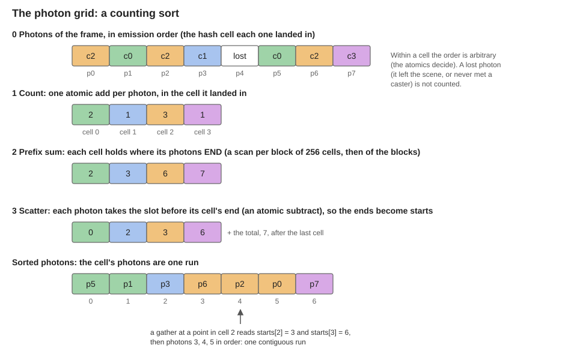

Five small compute passes do it (`causticCountMain`, `causticScanBlocksMain`, `causticScanSumsMain`,
`causticAddOffsetsMain`, `causticScatterMain`), launched by `Caustics::cmdBuildGrid`. They know nothing of the scene,
so they are a shader of their own, built once. (They used to be entry points of the path tracer's module, which made
every rebuild of that shader compile six pipelines in a row: a stall of over a second. They are separate now.)

Why a sort, and not the classic linked list per cell: a list makes every photon a random memory read; a sorted run
is read in order, and one cell costs two loads and a loop.

### 4.4 Path tracing: add the splats, gather the map

The path-tracing pass runs the paths as usual (`shaders/gltf_pathtrace.slang`), with the partition of section 3.
At each covered receiver (`causticGather`), it gathers:

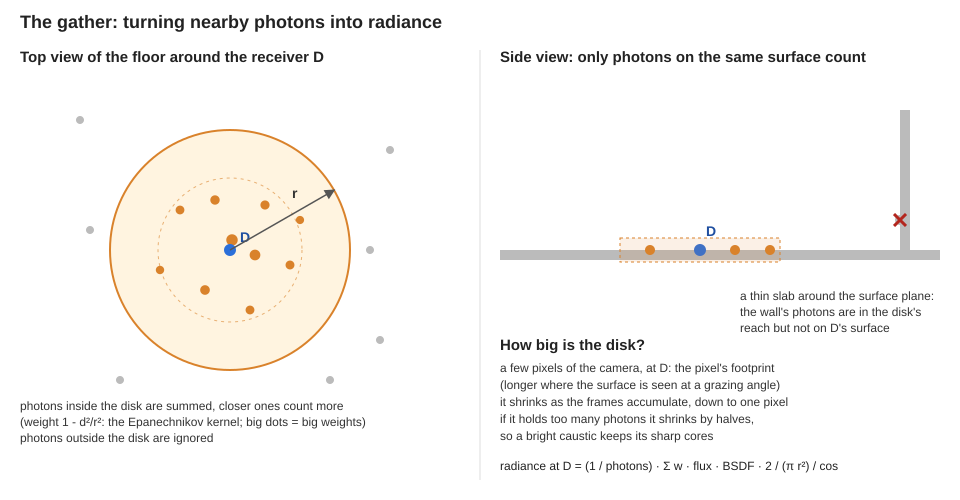

- **The disk.** Its radius is a few pixels of the camera *at the receiver* (`causticGatherRadius`: the pixel's
  footprint at that distance, longer when the surface is seen at a grazing angle). It shrinks over frames
  (section 5). It is also at most a world-space radius, so far-away receivers do not get absurdly big disks.
- **The photons that count.** The cells the disk overlaps are read; a photon counts if it lies in the disk *and on
  the receiver's surface* (a thin slab around the surface plane), so the photons of the wall behind a corner do not
  light the floor, and if it came from the side the path is on (a photon that lit the back of a thin quad does not
  light its front), unless the surface passes light through.
- **The weights.** Each photon is weighted by `1 - d²/r²` (the Epanechnikov kernel); the sum is divided by the
  number of photons traced and by `π r² / 2` (the kernel's integral), which turns "photons per area" into
  radiance after the BSDF, and by the geometric cosine toward the camera (the BSDF value carries the shading one, the
  adjoint correction the ratio of the two).
- **The BSDF.** A shiny receiver evaluates its BSDF for each photon (the highlight depends on where the photon came
  from); a rough one evaluates it once, for the direction the flux comes from on average, which is cheaper.
- **Crowded disks shrink.** If a disk holds more than `Caustics::kGatherMax` photons, it shrinks by halves of its
  area and is read again, so a very bright core keeps its sharpness and a gather costs a bounded amount. The last
  attempt reads everything: a gather must not lose its energy.

The result is added to the path's own radiance in a separate accumulator (`SampleResult::caustic`). The path's
**firefly clamp** does not apply to it: the peaks are the caustic, and a clamp would dim them (the splats were
never clamped either).

Finally the host's splat buffer is added to each pixel's sample average (`processPixel`), so splats and gathers
land in the **same image**, which every denoiser (DLSS Ray Reconstruction, OptiX, OIDN, the hand-off between them)
reads. No denoiser needs to know about caustics.

## 5. Why the picture converges

In one frame, a gather disk of one or two pixels holds a handful of photons or none: the picture is **noisy**. A
wider disk would hold more, and be smooth, and **blurry**. We want both: sharp *and* quiet.

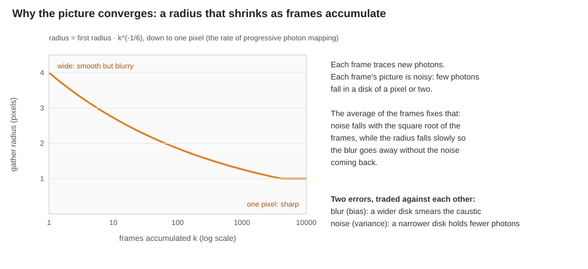

The trick is the one of *progressive photon mapping*: every frame is a fresh batch of photons, and the **average of
the frames** supplies the noise reduction (noise falls with the square root of the frames). Meanwhile the disk
starts wide, which is smooth for the first frames, and shrinks slowly, so the blur vanishes and the noise stays under
control. The radius goes as *k^(-1/6)* in the frame count *k* (the rate that balances the two errors in progressive
photon mapping), down to one pixel (`Caustics::kMinGatherPixels`), below which a disk would only add noise: the
pixel is the resolution.

A camera move or an edit restarts the accumulation, so *k* and the radius restart too: a few frames of a smooth,
slightly blurred picture, then it sharpens. Splats are not affected: they have no radius.

The photon count per frame follows the render size by default, a quarter of the pixels
(`ptCausticPhotonsAuto`). A photon that reaches what the camera sees lights one pixel, so a frame with fewer than that
leaves the image speckled. The map keeps at most `Caustics::kMapSlots` of them.

## 6. Settings and cost

| Setting | Meaning |
|---|---|
| Caustics | Enable the feature. Persisted; restarts the accumulation. |
| Photons per frame (automatic or manual) | Automatic follows the render size; manual is a count. Ranges and caps are in `src/caustics.*`. |
| Photon map | Covers receivers behind casters and after a bounce. Off: only what the camera sees directly has a caustic. |
| Gather radius | The gather's first radius, in pixels of the camera; it shrinks as the accumulation grows. Larger: smoother, blurrier at first. |

The setting names, defaults and ranges are declared in `Caustics::registerParameters` (`src/caustics.cpp`).

**Cost.** Off: nothing. On, splats alone: the photon pass (it scales with the photon count) and a path tracer
variant that is a little slower. The map adds the counting sort over the frame's photons and a **gather at every
covered receiver of every path**, so it scales with how much of the view is seen through glass and with the number of
receivers that gather. A view that is all behind a pane is the worst case. In practice the **gather dominates**; the
photon pass and the grid are a small part of the frame (section 7). Memory: the photons, their sorted copy and the
grid, allocated when the setting is first on, and the splat buffer, which grows to the largest render size so far (a
render size that comes back, as with DLSS, reuses it).

**Pipelines.** The photon pass is part of the path tracer's shader module (it needs the scene's materials and
acceleration structure), so it is rebuilt whenever that shader is: with the optimized variant, with a DLSS toggle.
That rebuild is the one stall the feature still causes (about a second); see the ideas.

## 7. What we measured

These are measurements on the development machine, one NVIDIA GPU, at the dates and scenes named: they show how
the design choices behave and give a baseline to beat; they are not specifications. The reference for "error" is a
converged render (many frames of many photons, radius of one pixel); the metric is the root-mean-square
difference over the mean ("err", at full resolution; "err8" after averaging 8×8 blocks: the picture without its
noise). Scene: the Cornell Caustic box with a water volume (thickness added), 800×800, 1 sample per frame.

**Photon lifetime and radius** (error against the reference after 512 frames, unless said):

| Configuration | err | err8 |
|---|---|---|
| 262 144 photons per frame, first radius 4 px (the default radius) | 0.08 | 0.016 |
| …first radius 2 px | 0.09 | 0.017 |
| …first radius 8 px | 0.13 | 0.026 |
| …at 64 frames, first radius 4 / 2 px | 0.16 / 0.23 | 0.037 / 0.042 |
| …with 65 536 photons per frame | 0.12 | 0.027 |
| …with 16 384 photons per frame | 0.21 | 0.051 |

Lessons: **photons per frame is the strongest lever**; a first radius of 4 px beats 2 px early (smoother) and ties
later; 8 px is too blurry. An earlier design kept the last 2M photons in a ring valid until the scene changed. At
the *same photons per frame* it was no better, its effective photon count was capped by the ring, its noise was
correlated from frame to frame (the same photons stay for many frames; not measured on its own), and it needed a
cache to keep valid; it was dropped.

**Receivers that gather** (same scene; mean of the image, and path-trace pass time at 1280×720):

| Receivers per path | image mean | pass time (cells 4 radii wide) | pass time (cells 1 radius wide) |
|---|---|---|---|
| 1 (first only) | 0.186 | 1.9 ms | 2.4 ms |
| 2 | 0.299 | 2.9 ms | 6.7 ms |
| 3 (default) | 0.327 | 3.4 ms | 9.5 ms |

The first receiver alone misses most of the caustic light of this scene: the pool's light bounces on the walls
and lights the box. A spot lighting a wall through a clear pane, which lights the floor, is a test of the same
thing (`tests/render/caustics.py`): with only the first receiver, it was 3.6% too dark; with the extra receivers,
within 0.2%.

**Cell size.** A gather reads the cells its disk overlaps, and each cell is a cache miss, so the grid's cell size
decides the speed: at two receivers, cells 1, 2, 4, 8, 16 and 32 gather radii wide took 7.5, 3.4, 2.9, 3.4, 6.3 and
12.8 ms. The default (`Caustics::kCellRadii`) is the best of those. Reading more cells is the expensive part, not reading more photons.

**Aim.** Two glass balls 50 units apart, camera at one, 4 frames of 16 384 photons: error 4.6 with one sphere around
both, 0.11 with spheres around each ball.

**Where the gather's time goes.** Measured by switching parts of the gather off, on the pool scene at 1280×720 and
262 144 photons (the path-trace pass is about 0.95 ms without caustics, 2.6 ms with the map before the change below):

| What is left of the gather | pass | path tracer's registers |
|---|---|---|
| it returns at once (the partition and the call) | 0.97 ms | 128 |
| + reading the cell runs | 1.0 ms | 128 |
| + reading the photons and the disk test | 1.2 ms | 128 |
| + decoding the photons' directions | 1.85 ms | 162 |
| everything | 2.55 ms | 168 |

The cost is not in the work the gather does: a gather holds a few photons (changing the cap on photons per gather from
8 to 100 000 changed neither the time nor the error), the cell lookups and the empty cells are nearly free, and the
partition is free. It is in **the register count of the whole path tracer**, which goes from 128 to 168 as soon as the
gather's loop does real work, so every path pays for it in occupancy, gather or not. Marking the sum `noinline` does
not help (the driver inlines it). Consequences: shrinking the *code* of the gather matters more than shrinking its
work, and a gather in a pass of its own (deferred, so that the megakernel keeps its registers) is the structural fix;
see the ideas. One cheap step: the sum is instantiated twice (`causticSum<1>` for a shiny receiver, which evaluates a
BSDF per photon, `<0>` for the others), instead of one loop with a branch for both: 2.6 to 2.1 ms on the pool scene
(1.27 to 1.22 ms on the Veach room), with the same error.

**Crowded cells.** A gather used to fail whenever it had *read* too many photons, which a crowded cell (the core of
a caustic, in a cell several radii wide) does however small the disk gets, so it shrank the disk pass after pass and
then read the whole cell. A cell now bounds the reads (a stride, each photon standing for that many): the path-trace
pass went from 3.55 to 2.59 ms at 262 144 photons and from 8.80 to 6.32 ms at 1 048 576, with the same mean and about 8%
more noise (the old limit forced sharper, noisier disks in the cores).

**Photon pass and grid.** About 0.3 ms at 262 144 photons and 1280×720.

**Pitfalls found on the way** (so that the next person does not repeat them):

- **Push constants.** The grid's passes use a pipeline layout of their own. Pushing constants through it left the
  path tracer's push constants undefined for the next dispatch (the first words, `maxDepth` and `frameCount`, were
  overwritten): a fixed pepper of dark and bright pixels that never converged. The constants are pushed again after the
  grid. Tests that compare *means* do not see this; `tests/render/caustics.py` now compares the floor pixel for pixel,
  with the map on and off.
- **Firefly clamp.** It once clamped the gathered light but not the splats. The map's light now bypasses it.
- **Setting semantics.** A setting whose meaning changes keeps its saved value. The photon count changed from
  "per sample" to "per frame" and a saved small value left images speckled; the setting was renamed.
- **Thin-walled water.** A scene converted from a renderer where a dielectric is a solid (PBRT's `dielectric`, as in
  the Cornell Caustic scene of the glTF research scenes) has transmission and an IOR but no volume. glTF reads that as
  thin-walled: no refraction, no caustic. Add `KHR_materials_volume` thickness.
- **Shaders are compiled at run time from the source tree** in a development build, so an old executable run against
  new shaders is a different program: compare builds in separate trees.
- **The firefly clamp is recalibrated** when the environment loads, so `--ptFireflyClamp` on the command line does
  not stick in a headless run.

## 8. Limits and known biases

- The photons cover the first few receivers of a camera path that are not casters (`CAUSTIC_MAP_RECEIVERS`); a
  caustic that lights a surface that lights another beyond them is the path tracer's again, and noisy.
- A transmissive material without `KHR_materials_volume` thickness is thin-walled (the glTF rule): no refraction, so
  no caustic, and it is not a caster: the path tracer handles the light seen through it as without this feature.
- Casters are smooth (see `isCausticCaster()`) and opaque in coverage; a stochastic-blend caster is not handled. No
  volume scattering inside casters; with an orthographic camera the feature is
  off (the splats project with a perspective camera's measure); the camera medium is ignored; no dispersion.
- The path tracer's **roughness regularization** (a surface after a rough one is at least as rough, glass included)
  still blurs the glass of paths the photons do not cover. That is a separate known issue of the path tracer.
- Photons end after `CAUSTIC_MAX_DEPTH` caster interactions.
- A gather's disk is capped at a few cells of the grid (`CAUSTIC_MAX_RADIUS_CELLS`), so a receiver far from the
  casters is noisier rather than slower.
- A rough receiver evaluates its BSDF once, for the mean direction of the photons: exact for a diffuse one, biased
  for a glossy one between the shiny and the rough threshold (`CAUSTIC_SHINY_ROUGHNESS`). A transmissive receiver
  evaluates it for each photon.
- A photon has one slot in the map. A thin pane lit through a caster stores the photon (for the splats, which are
  separate, it always counts), but a photon that goes on through the pane lands again and replaces that entry. A
  camera path that gathers at such a pane after a bounce therefore misses the photons that went through it; those
  that stop at the pane are kept. Two slots per photon would fix it, at twice the map memory.
- The caster bounds are rebuilt on the CPU when node transforms change, in time proportional to the number of
  caster nodes: a scene with very many animated casters pays for it every frame.
- Shadow Transmission remains the approximation for light seen from surfaces the caustics do not cover.
- Caster bounds follow node and material changes; a skinned or morphed caster is bounded by the whole scene.
- **What is biased, and how.** The gather's blur (the radius shrinks with the accumulation, down to one pixel); the
  adjoint correction capped at grazing angles (`causticAdjoint`); a crowded cell, read with a stride (`CAUSTIC_CELL_READS`; unbiased, but noisier
  in the core of a caustic); the camera's straight-line
  distance used for the footprint of a receiver seen through glass (refraction magnifies or minifies it). The 8-bit
  flux packing is rounded to the nearest: an error of at most a 510th of the brightest channel per photon. **Nothing clamps** the radiance of a photon or
  of a gather.
- With few photons per frame the picture is speckled and, under a denoiser, blotchy: neighbouring pixels see the
  same photons (see the ideas).

## 9. Ideas to make it better

The goal is a caustic that is sharp, quiet and converges in a few frames, at a cost that fits in a real-time frame.
The sections below group ideas by what they attack. For each: what it is, why it should help, what it costs, and how
to tell if it worked. **These are ideas and hypotheses, not results**, except where a measurement is quoted.
Section 11 explains how to measure a change.

### 9.1 Less noise

1. **Pick emitters in proportion to their power.** Today a photon picks its emitter as the light sampler does: the
   punctual lights equally, the emissive triangles by power, environment and lights by a fixed split. A dim light then
   gets as many photons as a bright one, and the photons carry very different fluxes: a few very bright photons make
   noise that no radius cures. A table built by power (an alias table over emitters: spots by their solid angle,
   sun and sky by the power through the caster spheres, triangles by area × luminance) makes every photon carry about
   the same flux. *Cost:* a host-built table, refreshed when the lights change. *Test:* the variance of the splat
   image on a scene with two lights of very different power.
2. **Splat with a reconstruction filter.** A splat adds to the single pixel the photon projects to, a box
   filter, while the path tracer jitters its camera samples across the pixel and so effectively uses a wider filter.
   Spreading the splat over the neighbouring pixels (a tent of about a pixel) removes the one-pixel salt noise at
   the price of a slight blur that the path tracer already has. *Cost:* four atomic adds instead of one. Small change,
   likely a visible gain in the speckle.
3. **Decorrelate the estimates of neighbouring pixels.** Neighbouring pixels gather the *same* photons, so their
   errors are alike: a blotchy picture, which a denoiser mistakes for structure. One way to break that: at the first hit,
   let each pixel accept a random quarter of the photons (a repeating 2×2 pattern with a random shift per frame) and
   scale the flux by four: the same expected value, errors that differ from pixel to pixel, which a denoiser removes well.
4. **Per-point radius (stochastic progressive photon mapping).** Today the radius is the same function of the frame
   count for every point. The real algorithm keeps, per visible point, the photon count and radius and shrinks the
   radius where photons are dense and keeps it large where they are sparse, so dense caustic cores get sharp early and
   dim areas stay smooth. *Cost:* a per-pixel record (visible point, normal, count, radius, flux); it fits poorly
   with a moving camera or with DLSS's jitter, which move the points every frame.
5. **A minimum number of photons.** Grow the radius until a minimum count is held (k-nearest-neighbour density
   estimation) in sparse regions, and shrink in dense ones. It removes isolated dots, at the price of blur exactly
   where there is little light to be sharp about. The earlier ring design did this (a fixed K) and was blurrier
   than the current one at the same photons.
6. **Separate the caustic from the picture for the denoiser.** Feed the caustic radiance as its own layer or guide
   (the denoisers are good with a clean albedo and normals, bad with high-frequency light that moves relative to the
   surface). Today it is mixed with the path-traced light.
7. **Combine estimators with multiple importance sampling** instead of the hard partition (vertex connection and
   merging, VCM): the path tracer's rare lucky caustic paths and the photons get weights, so the partition's edges
   are not a bias and paths that the partition gives up are not wasted. *Cost:* large; the partition is simple and
   exact today.
8. **Manifold next-event estimation** (MNEE; Hanika et al. 2015; specular manifold sampling, Zeltner et al. 2020)
   for the *first-bounce* caustics of area lights: a camera path at a diffuse surface searches for the specular path
   that connects it to the light through the glass, by Newton iteration. Noise-free sharp caustics for a single
   refraction or reflection with no photons. It is the best known way to get "sharp and quiet" in
   the simple case, and complements photons for the cases it cannot do (several casters, rough ones, distant lights).

### 9.2 Sharper

1. **A footprint that follows the glass.** The gather radius uses the straight distance from the camera to the
   receiver. Through glass the pixel's footprint is magnified or minified by the refraction. Carrying a **ray cone or
   ray differentials** through the casters gives the true footprint, so the radius is the pixel through the glass.
2. **Anisotropic disks.** Caustics are thin bright lines. A disk is isotropic and blurs across the line as much as
   along it. An ellipse aligned with the line (from the photon density's gradient, or from photon differentials) keeps the
   line sharp and averages along it.
3. **Photon differentials.** Carry the spread of the photon beam (how its footprint grows) with the photon, so each
   photon is a small footprint, not a point: the density at a point comes out right with far fewer photons, and caustic
   edges stay sharp. Needs the Jacobian of each refraction.
4. **Spend photons where the camera looks** (already done by the view-weighted spheres). Push it further: sample
   directions by *importance*, the product of the light and of how much of the view each direction's landing point
   covers (photon path guiding).
5. **Sub-pixel radius with supersampling** only when the photon density allows it: below one pixel nothing is gained
   at one sample per pixel.

### 9.3 Faster

1. **Cull the gather.** Most receivers are nowhere near a caustic, so an occupancy bit per cell (a bitset small
   enough to stay in cache) should reject an empty cell with one cheap load instead of two cache-missing ones.
   **Tried, and it did not help**: built in the counting-sort pass and tested before each cell, it changed the
   path-trace pass by less than the noise on the pool scene (2.59 → 2.73 ms at 262 144 photons) and on the Veach room,
   so it was removed. The cost is not in empty cells. Worth finding out where it is (the photon reads of occupied cells,
   the BSDF, the shrink passes) before trying a culling structure again: a bounding box of the landed photons is the
   cheaper test of the same idea.
2. **Take the gather out of the path-tracing kernel.** The measurements in section 7 say the gather's cost is the
   registers it adds to the whole path tracer (128 to 168), not the work it does. A deferred gather (the path
   records its receiver and what it needs, a separate pass gathers, a final step adds the result) keeps the main
   kernel at its old occupancy. *Cost:* a record per receiver per sample (position, normals, the throughput and what
   the BSDF needs: a Lambertian approximation would shrink it), and a change in how the path tracer is structured. The
   largest known gain left for the cost of the gather.
3. **A second, coarser grid for deeper receivers** (a fine layer for pixel-sized queries and a
   coarse one for deep ones). One grid today serves every receiver; its cell size follows the radius at the casters'
   distance.
4. **A cache of the caustic's irradiance** in a world-space hash grid: each frame, deposit the photons into a grid of
   irradiance, accumulated over frames with a decay. A gather becomes one lookup (with filtering). Temporal
   accumulation comes free, and the cost no longer grows with the receivers. *Risk:* the cache is a persistent state
   that must be invalidated when anything that affects light changes, which the previous ring design needed and which
   the current per-frame design avoids on purpose; resolution of the grid bounds the sharpness.
5. **Fewer receivers, chosen stochastically.** Gather at the second and third receivers with a probability and
   weight by its inverse: less cost, a little more noise exactly where the light is smooth.
6. **Sort the queries.** The gathers of neighbouring pixels read the same cells; ordering the work by cell (or
   by screen tile) turns cache misses into hits.
7. **Compact photons** (12 bytes: a position quantised in the scene's box, a shared-exponent flux, an
   octahedral direction in 16 bits) to halve the memory read per photon.
8. **Compile the photon pass in the background** and skip the caustics until it is ready, as the optimized shader
   already is, to remove the last stall of about a second at each shader rebuild.
9. **Cheaper photon flight.** The photon pass evaluates full materials at each caster. A casters-only evaluation
   (only the lobes that matter) is smaller code, which also helps the occupancy of the megakernel it shares.

### 9.4 Converging in fewer frames

1. **Quasi-random photons across frames.** The aim already uses a low-discrepancy sequence within a frame. Extend
   it across frames (an Owen-scrambled Sobol or R2 sequence indexed by the running photon number), for the emitter, the
   point on it, the BSDF choice: the average over frames then converges faster than 1/√N.
2. **Adaptive photon count.** Trace more photons when the image is changing (a moved camera, the first frames),
   fewer when it has converged; tie it to the Auto SPP budget.
3. **Reuse across frames** where the scene is static: resample the photons of previous frames (reservoirs, as in
   ReSTIR for path tracing) instead of discarding them. Needs the validity rules the per-frame design avoids; the old
   ring was a crude form of this and, at equal photons, gave no gain.
4. **Start sharper when it is safe.** The first radius could depend on the scene's photon density (a bright
   caustic tolerates a smaller radius) instead of a fixed number of pixels.

### 9.5 Coverage and robustness

- **Solid dielectrics from converters** (no `KHR_materials_volume`): an option to treat a closed transmissive mesh as
  a solid, or a converter that writes a thickness, so that scenes like the Cornell Caustic work as authored.
- **Dispersion** (continuous wavelengths on the photons), **alpha cutouts** and **media** (photon
  beams for the caustics through water with scattering), **rough casters** (glossy caustics through the gather),
  **orthographic** cameras.
- **Gather at later receivers** without the fixed count: Russian roulette on the number of receivers.
- **Interaction with the path tracer's roughness regularization**: skip it on casters when the photons cover the
  path, or on transmissive hits in general (GitHub issue 50).

## 10. Where the code is

| What | Where |
|---|---|
| Settings, UI, bounds, clusters, per-frame parameters, the grid's pipelines | `src/caustics.hpp`, `src/caustics.cpp` |
| Dispatching the photon pass and the grid; the photon pass pipeline | `PathTracer::traceCaustics`, `PathTracer::causticPipeline` (`src/renderer_pathtracer.cpp`) |
| Shared host/device structs | `CausticPhoton`, `CausticSphere`, `CausticParams` in `shaders/shaderio.h` |
| Caster test, emission, photon flight, splat, gather, partition | `shaders/caustics.h.slang` |
| Hash cells (shared by the gather and the grid) | `shaders/caustics_grid.h.slang` |
| The counting sort | `shaders/caustics_grid.slang` |
| Hooks in the path tracer | `shaders/gltf_pathtrace.slang` (`causticAdvance`, gather, splat add, the clamp), `PathTracerState` and `SampleResult` in `shaders/pathtrace_functions.h.slang` |
| Tests | `tests/render/caustics.py` |

A reading order that works: this page, then `Caustics::cmdPrepare`, `causticMain` and `tracePhoton`,
`causticGather`, and the hooks in `gltf_pathtrace.slang` (search for `USE_CAUSTICS`).

## 11. Working on it

**Run the checks.**

```bash
python tests/render/caustics.py --exe <path-to-vk_gltf_renderer> [--technique 1] [--windowed]
```

They check, among others: that off is the default and a scene without casters is unchanged; that a clear, index-1 pane
lights the floor like the open scene (the energy of the estimators, for point and area lights, with the camera under
the pane for the splats and above it for the map); that a wall lit through a pane lights the floor as the plain path
tracer does (a second receiver); that a glass ball's caustic looks the same seen through a clear pane (the map) as
directly (the splats); that the map leaves the floor it does not light alone, pixel for pixel; that the photons find
two balls far apart; and, with `--windowed`, that a scene change shows at once. They are energy and consistency
tests: a change that makes the picture noisier or blurrier will pass them. For that, measure.

**Measure a change.** The recipe used for section 7:

1. Pick scenes: a pool-like box with a volume (caustics seen through glass, bounces), the Veach bidirectional room
   (`gltf-research-scenes/scenes/veach-bidir`, with a thickness added to the glass), two far-apart balls (the test
   scene), a scene with a pane over everything (the worst case for the gather).
2. Render a **reference**: headless, many frames of many photons, a radius of one pixel
   (`--ptCausticGatherRadius 1 --ptCausticPhotonsAuto 0 --ptCausticPhotonsPerFrame <big>`).
3. Render the candidate at the frame counts that matter (64 for interaction, 512 for converged), with the same
   settings otherwise, and compute the error against the reference (a script in `tests/render/caustics.py` has the
   image reader and the metric). Look at both numbers: noise (full resolution) and blur (after averaging blocks).
4. Time it: the GPU timers print "Caustics" (photons + grid) and "Path Trace" per frame (`--benchmark 1`, a
   sequence file; see [benchmarking.md](benchmarking.md)). The gather's cost is the difference of the path-trace time
   with and without the map.
5. **Look at the image** at full size, converged and at 64 frames, with the denoisers off and then on. Numbers are
   necessary and not sufficient: blotchiness is a look, and it is what a denoiser exaggerates.

**Compare builds in separate trees**, shaders being compiled at run time from the source tree.

**Keep the partition exact.** Any new estimator or receiver rule must keep "every light path is counted by exactly
one estimator"; the energy tests above are what enforce it.
