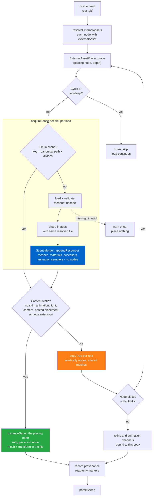
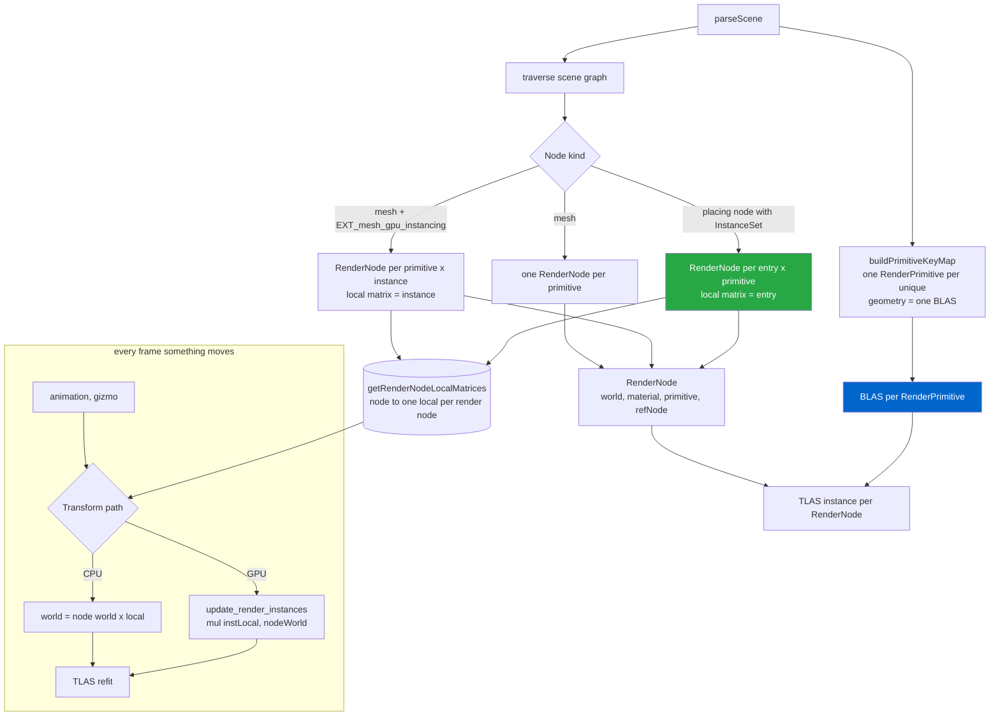
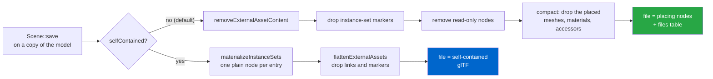

# External Assets (glTF 2.1 complex scenes)

> **For contributors and agents.** Authoritative design of glTF 2.1 external-asset load / place / edit / save. Concept-level; the symbols cited in `src/` are the source of truth for the details.

How `vk_gltf_renderer` loads, renders, edits, and saves glTF **2.1 external assets** — the
feature that lets one glTF file reference and instantiate *other* glTF files. This document is the
authoritative description of the mechanism; read it before touching the code paths below.

> **TL;DR** — A referencing (`externalAsset`) node's target file is loaded **once per scene** and
> its resources appended to the single runtime `tinygltf::Model`. Its content is then **placed**
> under every node that references it, at every nesting level: static content as an **instance
> set** on the placing node (no nodes), anything else as copied nodes. Placed nodes are flagged
> **read-only** by a marker written into each node's `extras`. On save, that marker is used to
> either strip the placed content back out (**re-externalize**, the default) or strip only the
> references and keep the geometry (**flatten**).

---

## 1. The glTF 2.1 data model

Three additions to core glTF, parsed/serialized by our fork of tinygltf
(`nvpro_core2/third_party/tinygltf/tiny_gltf.h`; see [gltf_2_1.md §4](gltf_2_1.md#4-tinygltf-fork)):

| JSON | tinygltf | Meaning |
|------|----------|---------|
| top-level `files[]`          | `Model::files` (`tinygltf::File`)           | A file reference: external `uri` **or** a `bufferView`, plus a required `mimeType`, plus optional `aliases`. |
| top-level `externalAssets[]` | `Model::externalAssets` (`tinygltf::ExternalAsset`) | An external glTF asset; its `file` indexes `files[]`. |
| `node.externalAsset`         | `Node::externalAsset` (int, `-1` = none)    | A node instantiating `externalAssets[externalAsset]` at its transform. |

A file with `node.externalAsset` set is a **complex scene**. The node carrying it is the
**instance node** or **placing node** (editable); everything loaded from the referenced file is
**placed content** (read-only).

> Note: tinygltf here is the C++ **v2** header, which upstream has replaced with an experimental C
> API. The renderer is built on v2, so external-asset support lives in our v2 fork (see
> [gltf_2_1.md §4](gltf_2_1.md#4-tinygltf-fork)). The runtime-only
> read-only marker is deliberately **not** a `Node` struct field (see §4) so the shared header is
> not polluted for a single application.

---

## 2. End-to-end flow

Three views: loading (what the placer turns a placing node into), rendering (how that becomes
render nodes, BLAS and TLAS), and saving. Section numbers point at the details.

**Load** (`Scene::load` → `resolveExternalAssets`, §3). Each referenced file is loaded and its
resources appended once per load (blue); the placer only makes nodes or instance sets. The
green/orange split decides the load cost: an instance set makes no node at all.

**Render** (`parseScene`, §6; data flow in [RENDERING_ARCHITECTURE.md](RENDERING_ARCHITECTURE.md)).
`EXT_mesh_gpu_instancing` and instance sets share one table of per-render-node local matrices, so
the CPU and GPU transform paths handle both alike.

**Edit** (`SceneEditor` + UI, §5): every mutator checks `isNodeReadOnly()` and refuses to touch
placed content; picking an instance-set entry selects its placing node.

**Save** (`Scene::save(filename, selfContained)`, §7), always on a copy of the model: the default
form writes back what was authored, the self-contained form writes the expansion as core glTF.

The runtime `m_model` always holds the fully-placed scene; the two save transforms run on a
throwaway copy.

---

## 3. Placing references (`resolveExternalAssets` + `ExternalAssetPlacer`)

`Scene::resolveExternalAssets()` (`gltf_scene_external_assets.cpp`) runs inside `load()`, **after**
`loadGltfFile` and **before** `parseScene`. It hands every node of the loaded file that has an
`externalAsset` to an `ExternalAssetPlacer`, which:

1. **Resolves** the reference (`externalAssets[i].file` → `files[j].uri`, percent-decoded, relative
   to the file that names it) and checks the cycle and depth rules (below).
2. **Acquires** the file: the first time a file is needed it is loaded (with the referencing entry's
   aliases), validated, meshopt-decoded, its image URIs rebased (below), and its resources appended
   to the scene model with `SceneMerger::appendResources` — buffers to meshes, materials, cameras,
   lights, micromaps and animation samplers, but **no nodes**. Only its JSON is kept afterwards.
   The cache key is the canonical path **and the alias context**: aliases belong to the referencing
   file, so the same file reached with other aliases is another entry.
3. **Places** it under the referencing node, in one of two ways:
   - **Static content** — no node of the file's default scene is skinned, animated, a light or a
     camera, places a file, or carries an extension (which may need a node of its own, e.g.
     `EXT_mesh_gpu_instancing`). The placing node gets an **instance set**
     (`nvvkgltf::InstanceSet`, found through `Scene::kInstanceSetKey` in its `extras`): one entry
     per mesh node of the file, with the mesh and its transform relative to the file's scene. No
     node is copied; the renderer expands the entries straight into render nodes (§6). Most kit
     pieces, buildings and props are static, so this is what keeps a city of many placements cheap
     to load.
   - **Anything else** — the file's default-scene roots and their descendants are copied under the
     referencing node as read-only nodes, which point at the shared resources through the file's
     offsets (`SceneMerger::remapNodeResources`). A node of the placed file that has an
     `externalAsset` places its own file inside the copy, recursively, through the same cache.
     Skins that target copied nodes, and animation channels, are duplicated per copy, so each
     placement animates on its own.
4. **Tags** every node it created read-only via `recordReferencedAsset` (which stamps the marker
   through `setExternalAssetMarker`) (§4).

So a file is loaded and its geometry uploaded once per load, however many nodes and files place it:
a kit piece used by every district of a city is one set of meshes, one `RenderPrimitive` per
primitive, one BLAS (§6). A node with `externalAsset` keeps its own `mesh`/`camera` only when its
file could not be loaded; otherwise they are cleared (spec: `externalAsset` takes precedence). The
editor's **Reference Scene** (`referenceScene`) creates such a node and places it the same way. The
`External assets:` log line counts the files loaded, images and buffers shared, placements, instance
sets and nodes created.

Before a file's resources are appended, `rebaseImageUris` rewrites its relative image URIs to be
relative to the folder of the scene. Images are later found through the scene-wide image search
paths, where the first match wins, so without this two assets using the same relative name for
different images (e.g. every Kenney kit's `Textures/colormap.png`) would both get the first one. The
same rebase runs for **Import/Merge Scene** (`mergeScene`).

The placer then **shares images between files**: an image of the file whose URI resolves, through
those search paths, to the same file on disk as an image already in the scene model is not appended;
the file's textures (and the `source` of their image extensions, e.g. `MSFT_texture_dds`) point at
the existing image instead (`ExternalAssetPlacer::shareImages`, `appendResources`' `sharedImages`).
Every Kenney kit piece reading its kit's `Textures/colormap.png` thus uploads it once per kit, not
once per piece. Only external files are shared: `data:` and bufferView images stay one per file.
Both save forms keep the sharing — the compaction drops nothing a texture still reads, and image
relocation already copies a shared source file once (§7).

**Buffers are shared the same way**, for the files of a *library* layout: each file declares its own
bufferViews and accessors into one `.bin` that several files name (e.g. every district of a city
reading `library/kenney.bin`). A buffer whose URI resolves to the same file on disk as a buffer
already in the scene model, and whose bytes are equal, is not appended; the file's bufferViews read
the existing buffer (`ExternalAssetPlacer::shareBuffers`, `appendResources`' `sharedBuffers`). The
bytes are compared because decoding (meshopt, Draco) may have rewritten a file's copy. The `.bin` is
then held once, and accessors of different files over the same bytes read the same buffer range,
which is what lets the renderer share their geometry (§6). GLB and `data:` buffers stay one per file.

Cycle detection uses the **placement path** — the canonical paths of the files from the scene down
to the file being placed. A file already on its own path is a back-edge: it is logged
(`reference cycle detected`) and skipped. The same file in two branches is not a cycle
(`A→B→D`, `A→C→D` is fine; `A↔B`, `A→B→C→A`, self-reference and child→root are caught). A
depth limit (`kMaxPlacementDepth`) stops anything deeper, and a node budget (`kMaxPlacedNodes`)
stops runaway multiplication of nested placements, both with a warning. A file that is missing,
unreadable or requires an unsupported extension is skipped with one warning; the load goes on. The
test fixtures are in `tests/gltf_2_1/generate_fixtures.py` (`external/`, `placement/`), the tests
`Gltf21Test.ExternalAssets_*` and `Gltf21Test.Placement_*`.

### `SceneMerger` (`gltf_scene_merger.{hpp,cpp}`)

- **`appendResources(base, imported, sharedImages)`** / **`remapNodeResources(node, offsets)`** —
  what the placer uses: append everything a node may point at, with every index rebased (images
  listed in `sharedImages` are mapped onto existing base images instead of appended), and return the
  offsets; then rebase the indices a copied node holds (mesh, camera, light,
  `EXT_mesh_gpu_instancing` accessors). Nodes, skins and channels are the caller's.
- **`merge(base, imported)`** — the whole-scene merge behind **Import/Merge Scene**.

> **Why merge into one model?** The renderer is hard-bound to a single `tinygltf::Model`: all GPU
> arrays (materials/textures/vertex/index buffers) are flat and indexed into that one model, and
> ray tracing already instances a shared BLAS via TLAS transforms. Keeping external assets as
> separate coexisting models would require per-model index offsets threaded through the CPU build,
> the `shaderio` structs, the shaders, and the editor — a much larger change for no runtime win.

> **Index remapping is exhaustive — extend it when you add an extension.** Because everything is
> appended into one model, *every* index the imported model stores must be rebased by the matching
> `IndexRemapping` field (see `computeOffsets` / the `remapAndAppend*` helpers in
> `gltf_scene_merger.cpp`). This includes indices buried inside **extensions**, both in the core
> arrays they point at (accessors, bufferViews, textures, …) and in any per-model array the
> extension defines itself. When an extension owns a root-level array (e.g. `KHR_lights_punctual`
> `lights[]`, `EXT_mesh_opacity_micromap` `micromaps[]`), that array must be concatenated onto the
> base's, a new `IndexRemapping` offset added for it, and the per-node / per-primitive references to
> it (and the bufferView/accessor indices it stores) remapped. A missed remap is silent: it either
> drops the extension (merged into an empty base, offset 0, so the un-copied root array simply never
> appears) or cross-links it to the wrong resource (non-empty base). **If you add a glTF extension
> that stores any index, add its remapping here in the same change.**

---

## 4. Read-only flagging (the `extras` marker)

Placed nodes must be recognisable as read-only *for the lifetime of the runtime model*, surviving
node renumbering (delete) and copying (duplicate). The mechanism:

- **Marker:** `Scene::kExternalAssetContentKey` = `"NV_external_asset_content"`, written into each
  placed node's **`extras`** (`gltf_scene.cpp`, `recordReferencedAsset`/`setExternalAssetMarker`). Its value is
  the index into `Scene::m_referencedAssets` (provenance: source URI + `file`/`externalAsset`
  indices).
- **Query:** `Scene::isNodeReadOnly(nodeIndex)` returns `node.extras.Has(marker)`;
  `Scene::isMeshReadOnly(meshIndex)` returns true if any read-only node or instance set uses that
  mesh.
- The **instance node itself is NOT marked** — it stays editable (you can move/rotate/scale the
  whole reference). Only the placed descendants are marked; an instance set has no nodes to mark.

### Why `extras` and not a set or a struct field

- A `std::unordered_set<int>` of node indices **goes stale** the moment `deleteNode` renumbers the
  node array — the previous implementation had exactly this bug.
- A field on `tinygltf::Node` would pollute the **shared** tinygltf header for one app.
- `extras` lives *inside* the node, so it is copied by `duplicateNode` and travels through
  `deleteNode` renumbering automatically — zero bookkeeping. It is standard glTF app-data. The
  instance-set marker (`Scene::kInstanceSetKey`) lives there for the same reason.

> ⚠️ **Invariant — never replace a node's `extras` wholesale.** Any code that does
> `node.extras = tinygltf::Value(newObject)` will wipe the marker, un-tagging placed content. Such
> a node then leaks into saves and **duplicates on reload**. Always *merge* keys into the existing
> `extras` object. (`applyRenderCameraToNode` in `gltf_scene.cpp` had this bug — it now preserves
> existing extras.)

---

## 5. Editing guards

The marker is enforced so referenced content cannot be edited, while the instance node stays free.

- **Editor** (`gltf_scene_editor.cpp`): `blockIfNodeReadOnly(nodeIndex, op)` early-returns (with a
  log) from every mutator that could change placed content — `setNodeTRS`, `renameNode`,
  `duplicateNode`, `deleteNode`, `setNodeParent`, `setNode*`/`clearNode*` (mesh/camera/skin),
  `duplicateMeshForNode`, `split`/`mergePrimitiveMaterial`. `setPrimitiveMaterial` is mesh-keyed so
  it guards via `isMeshReadOnly`. Undo commands and drag-drop route through these methods, so they
  are covered too.
- **UI**:
  - `ui_inspector.cpp` shows a `ICON_MS_LOCK Referenced asset (read-only)` badge and wraps the transform /
    light / camera / material controls in `ImGui::BeginDisabled(readOnly)`.
  - `ui_scene_browser.cpp` skips read-only roots in the **scene-transform** apply loop
    (`applySceneTransform`, which edits nodes directly, bypassing the editor) and disables the node
    context-menu mutations (duplicate/delete/add-child/rename) for read-only nodes. The per-node
    viewport gizmo instead routes through `SceneEditor::setNodeTRS`, which is guarded by
    `blockIfNodeReadOnly`.
  - Picking a render node of an instance set selects its placing node (`ui_renderer.cpp`).
- **Make Editable** (node context menu, `SceneEditor::makeExternalAssetEditable`) breaks the lock
  for every scene node placing the same file: their instance sets become nodes first
  (`Scene::materializeInstanceSets`, §6), then it clears their `externalAsset` and the marker of
  everything placed under them, so the content is saved inline. The command is not undoable; it
  clears the undo stack.

---

## 6. Rendering / instancing

`parseScene` builds one **`RenderPrimitive`** per unique geometry and one **`RenderNode`** per
(node, primitive) instance. The dedup key (`Scene::primitiveKey`) is the attribute and index accessor
indices, except in a scene with external assets, where it is the data each accessor reads: buffer,
byte offset, stride, count and format. Files that declare their own accessors over one shared `.bin`
(§3) then share a `RenderPrimitive`, as placements of one file do. Skinned and morphed primitives
keep the index key, since skinning and morphing write the `RenderPrimitive`'s own vertices; so do
sparse accessors. Placements of one skinned or animated file are copied as nodes but share the
file's skinned and morphed `RenderPrimitive`s and their skinning: each copied mesh node carries its
source (`Scene::kPlacedSourceKey`), and read-only copies of one source node animate in lockstep, so
one pose drawn at each placement is the right picture. **Make Editable** clears the marker, after
which each copy deforms on its own (RENDERING_ARCHITECTURE.md, "Deformed primitives"). A scene
without external assets keeps the index key. A placing node with an
instance set (§3) has no mesh of its own: it gets one render node per (entry, primitive), registered
under the placing node with no primitive index (`Scene::isInstanceSetRenderNode`). Like the render
nodes of an `EXT_mesh_gpu_instancing` node, each keeps a local matrix in
`Scene::getRenderNodeLocalMatrices()`, so moving the placing node moves every entry on the CPU and
GPU transform paths alike. A save writes the placing node as authored; a flattened save and
**Make Editable** turn the set into one plain node per entry (`Scene::materializeInstanceSets`),
with the name, morph weights and extras its node had in the placed file (`InstanceSet::sources`,
shared by every placement of that file). **Compact Scene** (`Scene::compactModel`) keeps the meshes
only instance sets draw and renumbers their entries.

Ray tracing builds one BLAS per `RenderPrimitive` and one TLAS instance per `RenderNode`. Because
every placement of a file points at the same appended accessors, N placements of the same file, from
any number of files, yield **one BLAS, N TLAS instances**; so do N files reading the same bytes of a
shared `.bin`. Verify with the BLAS count (the `Scene:` line of the log) when a file is placed more
than once.

The draft `uid` doesn't serve here: it is unique within its file only, so the same uid in two files
says nothing about their content. A reference to an object of another file would pair the file with
the uid, which core glTF 2.1 doesn't define; the buffer file and byte range is the identity a
library file already states.

---

## 7. Saving

`Scene::save(filename, selfContained)` (`gltf_scene.cpp`) transforms a **copy** of `m_model` when
`m_referencedAssets` is non-empty, then serializes the copy. Two forms:

### Re-externalize — `removeExternalAssetContent(model)` (default, `selfContained == false`)

Writes the **complex-scene** form (small top file that references the external files):

1. Drop the instance-set markers, and remove every node with the read-only marker, remapping all
   node-index references (children, scene roots, skin joints/skeleton, animation channel targets;
   empty animations erased).
2. Run the resource-compaction cascade (`collectReferencedResources` → remap tables →
   `extractUsedElements` → `updateAllReferences` → `::compactModel`) to drop the now-orphaned
   meshes/materials/skins/animations/accessors/etc. It runs whenever placed content existed, nodes
   or instance sets, since an instance set's meshes are orphaned without any node being removed.
3. Drop any buffer no `bufferView` references (a geometry-less complex scene has **no** buffer; an
   empty `byteLength: 0` buffer is invalid glTF and fails to load).

Result: instance nodes (keeping `externalAsset`) + the `files`/`externalAssets` tables, no inlined
geometry, no markers.

### Flatten — `flattenExternalAssets(model)` (`selfContained == true`)

Produces a **portable** self-contained file (shareable without the referenced assets): instance
sets first become plain nodes (`Scene::materializeInstanceSets`, §6), then it keeps the placed
geometry inline and instead strips every *reference* — clears `node.externalAsset`, removes the
markers from `extras`, and clears the `files`/`externalAssets` tables. The former instance nodes
become ordinary transform nodes.

Both functions live in `gltf_compact_scene.cpp` (declared in `gltf_compact_model.hpp`) and run on a
copy, so the live runtime scene is never disturbed.

### Image relocation (`.gltf` only)

When writing a text `.gltf` (not `.glb`), `Scene::save` relocates referenced `image.uri` files next
to the saved file. It resolves each URI through the load-time image search paths, then: **keeps in
place** any image that already resolves to the destination (a save-in-place, or a save-as into a
folder that already holds the referenced files, does not duplicate into `images/`); **deduplicates**
by canonical source path so a file shared by several entries is copied at most once; and otherwise
**copies** into `images/` with a uniquified name and rewrites the URI. See the `uriBySource` loop in
`Scene::save` (`gltf_scene.cpp`) for the exact rules.

---

## 8. File / symbol map

| Concern | Location |
|---|---|
| Parse/serialize `files`/`externalAssets`/`node.externalAsset` | `tiny_gltf.h` (nvpro_core2; fork branch `nv/all-fixes`) |
| Resolve + place on load | `Scene::resolveExternalAssets`, `ExternalAssetPlacer`, `gltf_scene_external_assets.cpp` |
| Append resources / remap a copied node | `SceneMerger::appendResources`, `SceneMerger::remapNodeResources`, `gltf_scene_merger.{hpp,cpp}` |
| Load a file, aliases, image rebase, meshopt | `nvvkgltf::detail`, `gltf_scene_loading.hpp` |
| Instance sets | `InstanceSet`, `Scene::getInstanceSet`, `Scene::isInstanceSetRenderNode`, `Scene::materializeInstanceSets`, `ExternalAssetPlacer::staticTree` / `addInstanceSet` |
| Read-only marker + queries | `Scene::kExternalAssetContentKey`, `isNodeReadOnly`, `isMeshReadOnly`, `ReferencedAsset`, `gltf_scene.{hpp,cpp}` |
| Editor guards | `SceneEditor::blockIfNodeReadOnly` + guarded mutators, `gltf_scene_editor.cpp` |
| UI (badge / disabled controls / gizmo skip) | `ui_inspector.cpp`, `ui_scene_browser.cpp` |
| Save (re-externalize / flatten) | `Scene::save`, `removeExternalAssetContent`, `flattenExternalAssets`, `gltf_scene.cpp` + `gltf_compact_scene.cpp` |

---

## 9. Known limitations / deferred work

- **Embedded external assets** (`file.bufferView` / `data:` URI) are not yet resolved — only
  external file `uri`s. This also applies to `FileAlias` targets: an alias whose `file` is stored
  in a `bufferView`/`data:` URI is skipped (only `uri`-backed alias targets are honored).
- **Save to a different folder** does not relocate/copy the referenced files or rewrite relative
  `file.uri`s (fine for save-in-place).
- **Animated, skinned, lit content, and content that places a file, is copied as nodes** per
  placement, each with its own animation channels: a crowd of identical characters evaluates its
  animation once per character. Instanced raster draws are also still to do.
- **Library geometry is shared only through the same `.bin` file** (§3, §6). Two files reading
  identical bytes from two different `.bin` files, or from GLB or `data:` buffers, keep one
  `RenderPrimitive` each. Skinned and morphed primitives keep the accessor-index key, so they are
  never shared across files; within one file a primitive drawn in several poses has one
  `RenderPrimitive` per pose (§6).
- **Placements of one skinned file draw one pose** (§6). Right while they play the file's animation
  in lockstep, which is all a read-only placement can do; per-placement animation state would need
  a pose (vertex buffers + BLAS) per placement.
- **Only image entries are shared, not textures or samplers.** Two files reading the same image
  file share its scene image (§3), but each keeps its own texture and sampler entries. An embedded
  image (`data:` URI, or a bufferView in a `.glb`) is never shared, even when its bytes are identical.
- **A placed file's `KHR_materials_variants` are not merged**, and its `KHR_animation_pointer`
  channels are dropped (with a warning). A skin whose joints lie outside the placed tree draws
  unskinned.
- **The file cache lives for one load** (or one Reference Scene); referencing a file again later
  appends its resources again.
- **Cycle detection is path-string based.** The ancestry check (§3) compares canonical paths with a
  case-sensitive string compare, and `weakly_canonical` does not normalize a path to its on-disk
  casing. On case-insensitive filesystems (Windows) a cycle reached through differently-cased paths
  (`a.gltf` ↔ `A.gltf`) or via hardlinks can slip past the check. In that case the
  `kMaxPlacementDepth` backstop still terminates recursion (with redundant placements and a
  warning) rather than hanging.

Implemented (glTF 2.1): nested external assets are resolved recursively with a cycle guard, each
file once per load, `FileAlias` inner-URI redirection is applied at load time, and `file.uri` is
percent-decoded.
